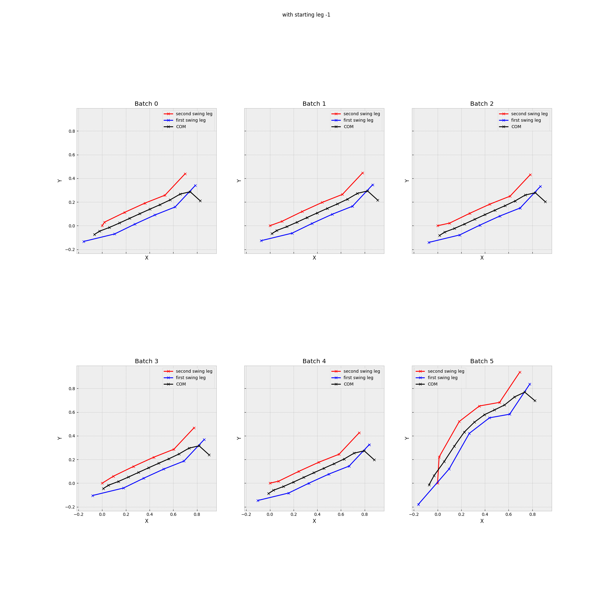

# ALIP-MPC in PyTorch

Batched, differentiable footstep MPC for bipedal walking, based on the
**Angular-momentum Linear Inverted Pendulum (ALIP)** model. Later integrated into
[VecPyPnC](https://github.com/carlosajove/VecPyPnC).

The ALIP code is in [`alip/`](alip): the model (`ALIP_model.py`) and two MPC formulations
(`ALIP_mpc_pytorch.py`, `ALIP_mpc_pytorch_withLinDx.py`).

Built on [mpc.pytorch](https://github.com/locuslab/mpc.pytorch) (Amos et al., 2018, MIT license).
